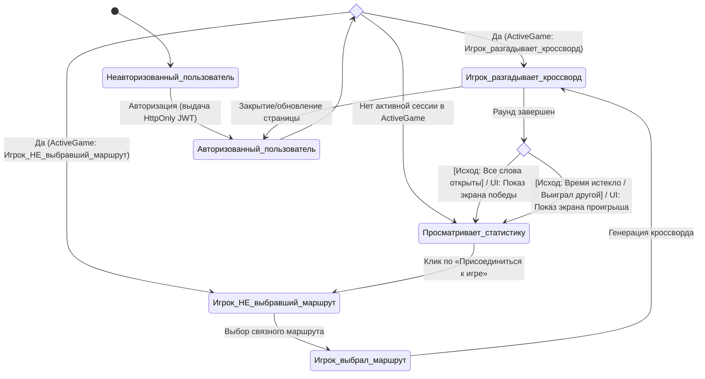

В состоянии `Просматривает_статистику` авторизованному пользователю открывается блок статистики игры с кнопкой `Присоединиться к игре` 
`Экран_Победы` и `Экран_Проигрыша` состояниями не являются - просто, в зависимости от того, как завершил текущий раунд игрок, ему демонстрируется фронтендом или `Поздравление с победой` (салют из конфетти, кубок, гифка с отходящим от станции поездом и гудок паровоза), или `Ободряющее сообщение о проигрыше`, но реально он уже переведен в состояние `Просматривает_статистику` (отдельных состояний игрока `Экран_Победы` и `Экран_Проигрыша` - НЕТ), ему снова открывается блок статистики игры с кнопкой `Присоединиться к игре` с возможностью присоединиться к следующему раунду игры даже если в момент демонстрации Экрана победы он закрыл или обновил страницу. 

Если игрок случайно прервал свой раунд, случайно закрыв страницу, но он все еще находится в ActiveGame как игрок в статусе `Игрок_разгадывает_кроссворд` (текущий раунд не завершился) - он может, заново получить доступ к странице со сгенерированным им кроссвордом - продолжить разгадывание кроссворда (в текущем раунде игры), поскольку в реальном мире его httponly jwt-Токен с заданным временем жизни будет сохранен его браузером и он останется авторизованным.     