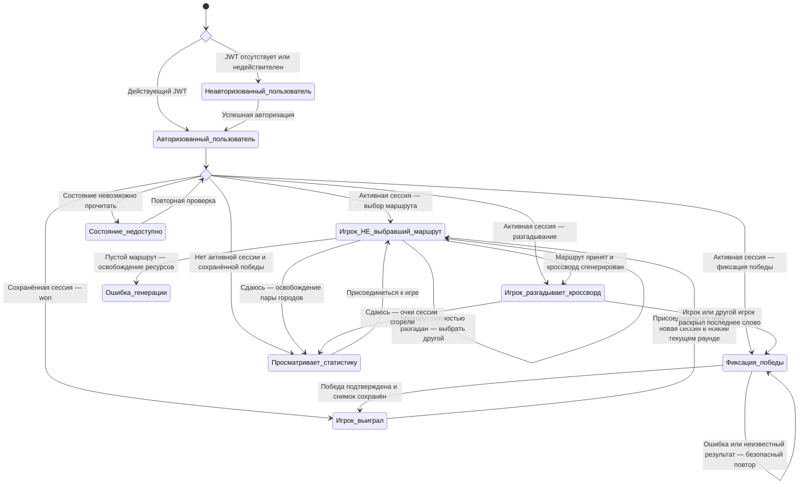

## Раунды и срок жизни данных

В состоянии `Просматривает_статистику` авторизованному пользователю открывается блок статистики игры с кнопкой `Присоединиться к игре` и карта для просмотра.

При выигрыше сессия больше не активна, но сохраняется в состоянии `won` вместе со снимком разгаданного кроссворда. На экране победы показываются кроссворд и кнопка `Присоединиться к игре`, запускается поезд и демонстрируется кубок. Снимок сохраняется до присоединения к новой игре или общего перезапуска, пока Redis не потерян. При присоединении создаётся новая сессия с новым идентификатором.

Сессия относится к игровому раунду с серверным `round_id`. Это отдельный идентификатор: `session_id` различает сессии игроков, `round_id` определяет группу сессий, которым разрешено совместно использовать участки, а Redis generation идентифицирует состояние одного развёртывания. При подтверждённой победе явный успешный переход к новой игре создаёт новый текущий `round_id`, если победившая сессия ещё относится к текущему раунду. Если другой победитель уже начал этот следующий раунд, новая сессия присоединяется к нему, а не создаёт ещё один. Другие активные сессии старого раунда продолжают играть в нём; их данные не переносятся в новый раунд.

Участок считается общим только при совпадении и `round_id`, и ID участка маршрута. Создание новой сессии заменяет сохранённую сессию победителя и освобождает её персональные данные и оставшиеся ссылки на старые участки. Общий объект участка старого раунда удаляется, когда от него освобождена последняя ссылка; до этого он остаётся доступен только сессиям того же старого раунда. Новый раунд получает собственные участки и слова даже при совпадении физических участков маршрута. Неуспешное присоединение из-за отсутствия пары городов не удаляет снимок победы и не меняет текущий раунд.

В состоянии `Фиксация_победы` победа ещё не показывается как подтверждённая; сдача и создание новой сессии недоступны. После подтверждения результата в PostgreSQL и сохранения снимка игрок получает `won`, в том числе через `/sync/`, если последнее слово открыл другой игрок. Клиент не применяет запоздавшие ответы с другим идентификатором сессии или более старой версией состояния той же сессии. Переход из `won` обратно к разгадыванию той же сессии недопустим.

Закрытие или обновление страницы само по себе не изменяет состояние игровой сессии на сервере. При следующем открытии страницы после проверки авторизации и сессии восстанавливаются выбор маршрута, кроссворд, фиксация победы или экран победы. Если срок действия JWT истёк, пользователь сначала повторно авторизуется; сохранённое состояние можно восстановить, пока оно доступно в Redis.

Недоступность Redis не означает отсутствие сессии: при невозможности прочитать или изменить состояние показывается ошибка, а создание новой сессии не считается успешным. После общего перезапуска прежние сессии и снимки побед не восстанавливаются; перезапуск отдельного worker их не сбрасывает. Подтверждённые в PostgreSQL очки сохраняются.

При полностью пустом маршруте приложение сообщает об ошибке генерации и освобождает зарезервированные сессией ресурсы. Последующий экран и формат ошибки определяются новым API-контрактом.
